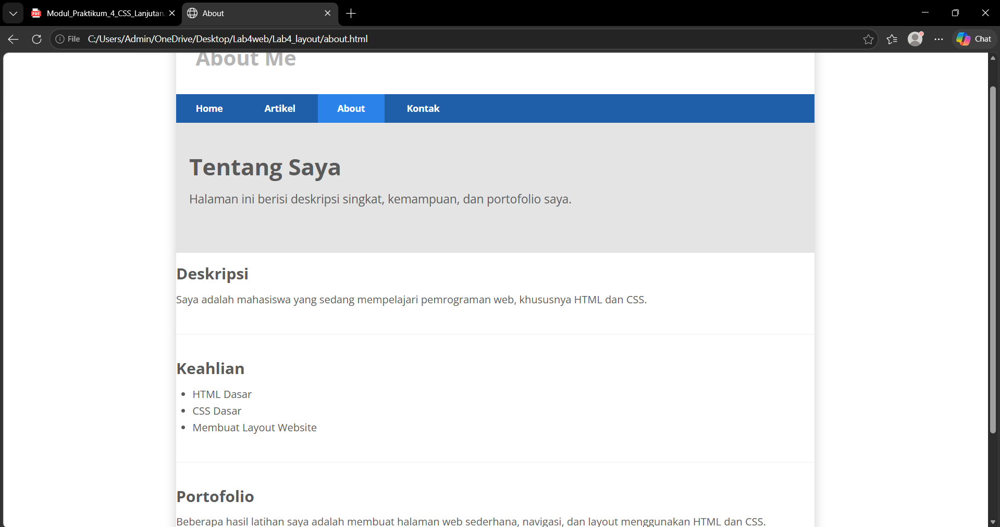
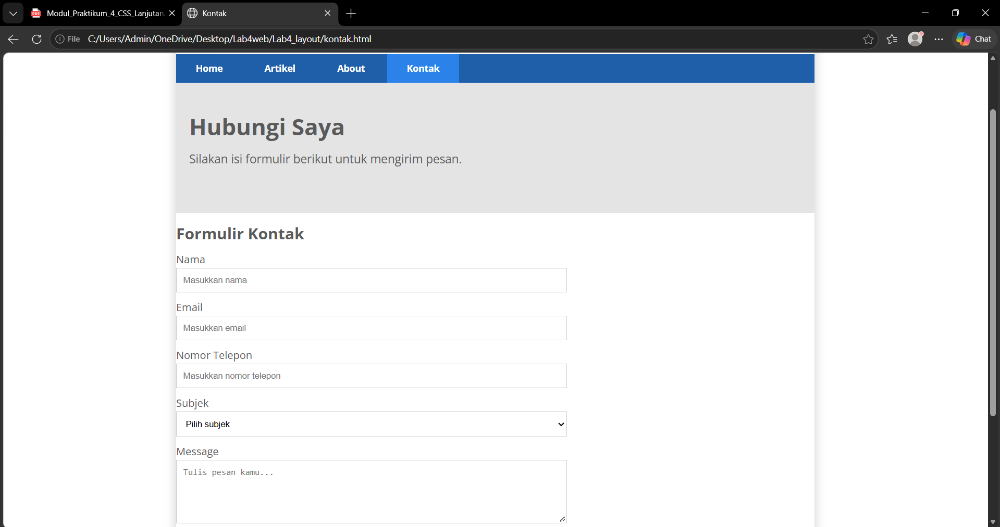

# Laporan Praktikum Pemrograman Web
## Praktikum 4 - CSS Layout

### 1. Tujuan Praktikum

Praktikum ini bertujuan untuk mempelajari cara mengatur tata letak halaman web menggunakan HTML dan CSS. Materi yang dipelajari meliputi penggunaan float, clear, header, navigasi, konten utama, sidebar, widget, artikel, footer, serta pembuatan halaman About dan Contact.

### 2. Alat dan Bahan

1. Laptop atau komputer.
2. Visual Studio Code.
3. Web browser.
4. HTML dan CSS.

### 3. Langkah-Langkah Praktikum

#### Langkah 1 - Membuat File Box Element

Membuat file `lab4_box.html` dengan struktur dasar HTML dan judul Box Element.

#### Langkah 2 - Menambahkan Elemen Div

Menambahkan empat elemen div dengan tulisan Div 1, Div 2, Div 3, dan Div 4 di dalam elemen section.

#### Langkah 3 - Mengatur Float dan Warna Div

Menambahkan CSS float dan padding. Div 1, Div 2, dan Div 3 diberi warna merah, kuning, dan hijau.

#### Langkah 4 - Mengatur Clear pada Div 4

Menambahkan warna biru, clear: left, dan float: none pada Div 4 agar posisinya berada di bawah tiga div sebelumnya.

#### Langkah 5 - Membuat Folder Layout Sederhana

Membuat folder `lab4_layout` yang berisi file HTML dan CSS untuk membuat halaman web dengan layout sederhana.

#### Langkah 6 - Membuat Kerangka Layout

Membuat struktur halaman menggunakan elemen header, nav, hero, wrapper, main, sidebar, dan footer pada file `home.html`.

#### Langkah 7 - Mengatur CSS Dasar

Menambahkan CSS untuk mengatur margin, padding, font, warna teks, lebar container, bayangan container, dan tampilan header.

#### Langkah 8 - Membuat Navigasi

Mengatur tampilan menu navigasi menggunakan CSS, termasuk warna latar belakang, warna teks, dan perubahan warna ketika menu diarahkan oleh kursor.

#### Langkah 9 - Membuat Hero Panel

Menambahkan judul Hello World!, paragraf, dan tautan Learn more pada bagian hero.

#### Langkah 10 - Mengatur Main Content dan Sidebar

Mengatur posisi dan lebar bagian konten utama serta sidebar menggunakan properti CSS float, width, dan padding.

#### Langkah 11 - Membuat Widget dan Footer

Menambahkan widget berisi daftar tautan, widget teks, dan footer sebagai bagian bawah halaman web.

#### Langkah 12 - Menambahkan Kotak Konten

Menambahkan tiga kotak konten yang berisi gambar, heading, paragraf, dan tombol View detail.

#### Langkah 13 - Menambahkan Artikel

Menambahkan dua artikel yang berisi judul, gambar, dan paragraf. Posisi gambar diatur menggunakan CSS agar dapat berada di sisi kiri atau kanan teks.

#### Langkah 14 - Membuat Halaman About

Membuat file `about.html` yang berisi deskripsi singkat, keahlian, dan portofolio. Halaman ini menggunakan stylesheet yang sama agar tampilannya konsisten dengan halaman utama.

#### Langkah 15 - Membuat Halaman Contact

Membuat file `kontak.html` yang berisi formulir kontak dengan isian nama, email, nomor telepon, subjek, dan pesan. Formulir dilengkapi tombol Kirim Pesan.

### 4. Hasil Praktikum

Praktikum menghasilkan halaman web dengan layout sederhana yang terdiri dari header, navigasi, hero panel, kotak konten, artikel, sidebar, dan footer. Selain itu, dibuat halaman About untuk menampilkan informasi dan portofolio serta halaman Contact yang berisi formulir kontak.

### 5. Kesimpulan

Dari praktikum ini, saya mempelajari penggunaan HTML dan CSS untuk membuat tata letak halaman web. Properti float dan clear membantu mengatur posisi elemen, sedangkan CSS lainnya digunakan untuk mengatur warna, ukuran, jarak, dan tampilan halaman. Saya juga mempelajari cara membuat beberapa halaman yang saling terhubung melalui menu navigasi serta membuat formulir kontak.