# Laporan Praktikum Pemrograman Web
## Praktikum 4 - CSS Layout

### 1. Tujuan Praktikum

Praktikum ini bertujuan untuk memahami penggunaan CSS dalam mengatur tata letak halaman web. Materi yang dipelajari meliputi penggunaan `float`, `clear`, header, navigasi, konten utama, sidebar, artikel, dan footer.

### 2. Alat dan Bahan

1. Laptop atau komputer.
2. Visual Studio Code.
3. Web browser.
4. HTML dan CSS.

### 3. Langkah-Langkah Praktikum

#### Langkah 1 - Membuat File Box Element

Membuat file `lab4_box.html` dengan struktur dasar HTML dan judul Box Element.

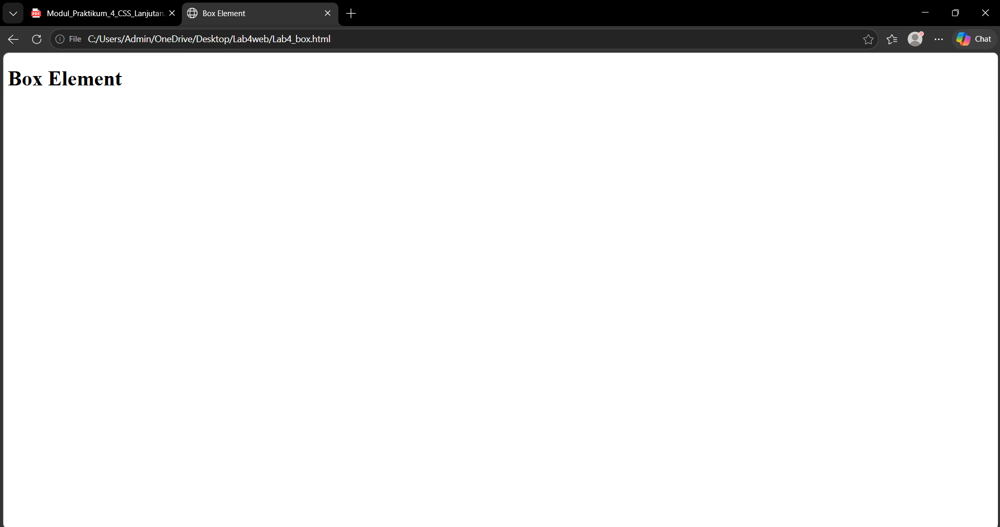

#### Langkah 2 - Menambahkan Elemen Div

Menambahkan empat elemen div dengan nama Div 1, Div 2, Div 3, dan Div 4 di dalam elemen section.

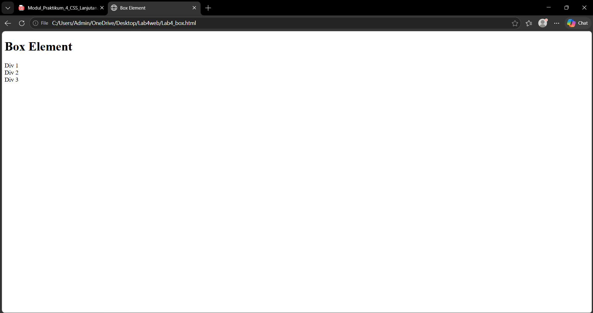

#### Langkah 3 - Mengatur Float dan Warna Div

Menambahkan CSS `float: left` dan `padding: 10px`. Setiap div diberi warna yang berbeda, yaitu merah, kuning, dan hijau.

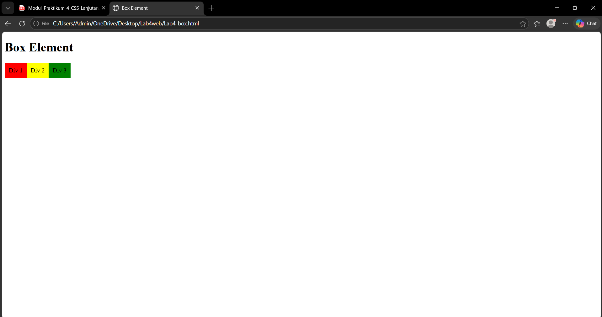

#### Langkah 4 - Mengatur Clearfix Element

Menambahkan Div 4 dengan warna biru, `clear: left`, dan `float: none`. Pengaturan ini membuat Div 4 berada di bawah elemen yang menggunakan float.

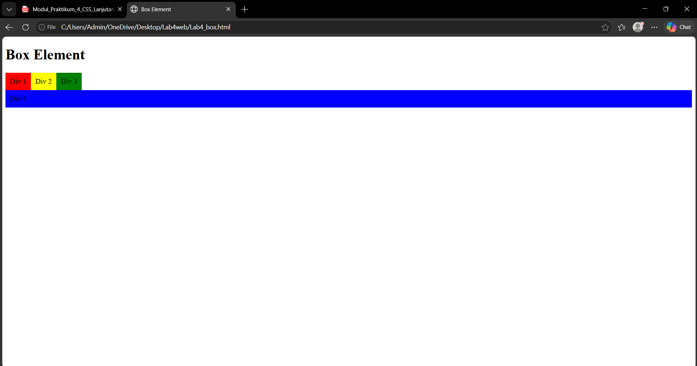

#### Langkah 5 - Membuat Folder Layout Sederhana

Membuat folder `lab4_layout` yang berisi file `home.html` dan `style.css`.

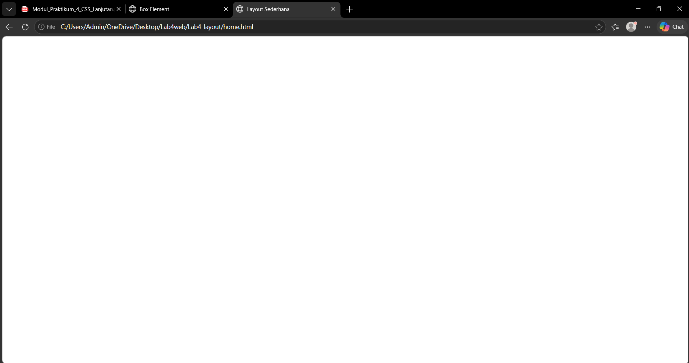

#### Langkah 6 - Membuat Kerangka Layout

Menambahkan elemen semantic HTML berupa header, nav, hero, wrapper, main, sidebar, dan footer pada file `home.html`.

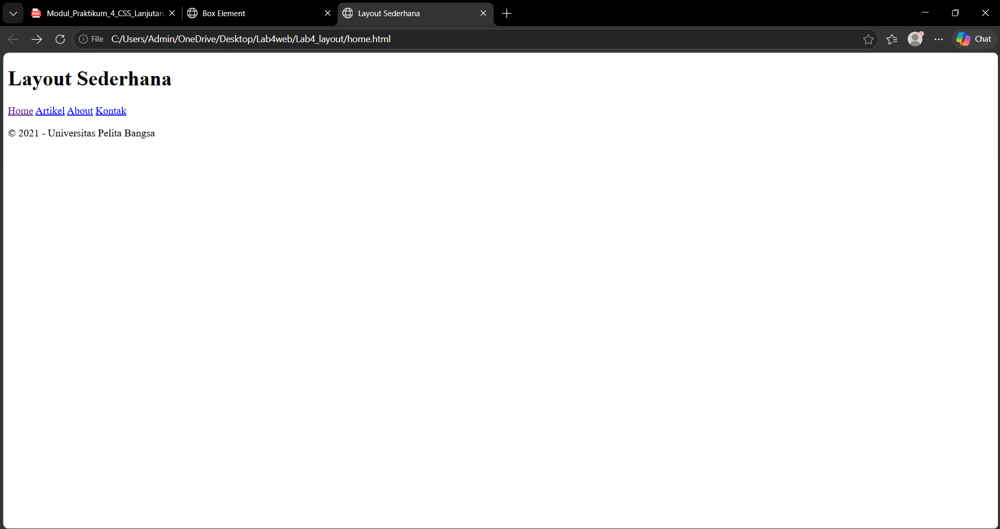

#### Langkah 7 - Mengatur CSS Dasar

Menambahkan CSS untuk mengatur margin, padding, jenis font, warna teks, lebar container, bayangan container, dan tampilan header.

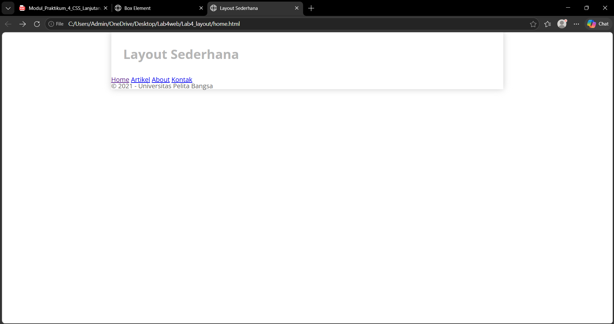

#### Langkah 8 - Membuat Navigasi

Menambahkan CSS pada elemen navigasi agar menu memiliki latar belakang biru, teks putih, dan perubahan warna ketika kursor diarahkan ke menu.

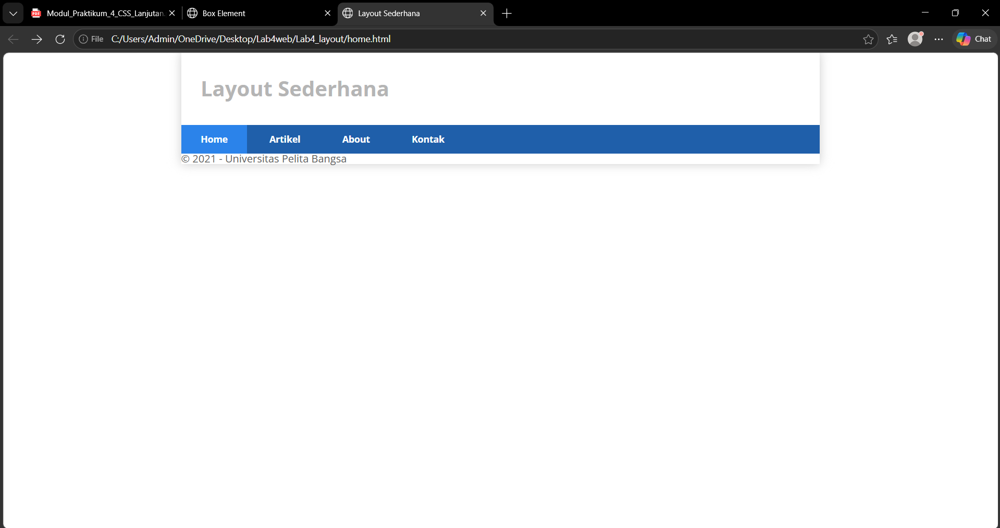

#### Langkah 9 - Membuat Hero Panel

Menambahkan judul Hello World!, paragraf, dan tautan Learn more pada bagian hero. CSS digunakan untuk mengatur warna latar belakang, jarak, dan ukuran teks.

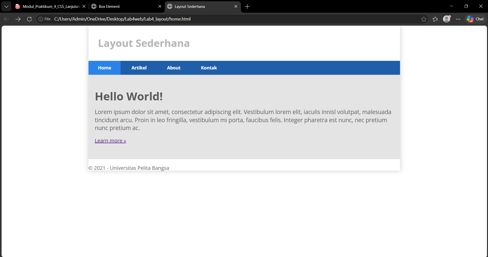

#### Langkah 10 - Mengatur Main Content dan Sidebar

Mengatur posisi dan lebar bagian main content serta sidebar menggunakan properti CSS `float`, `width`, dan `padding`.

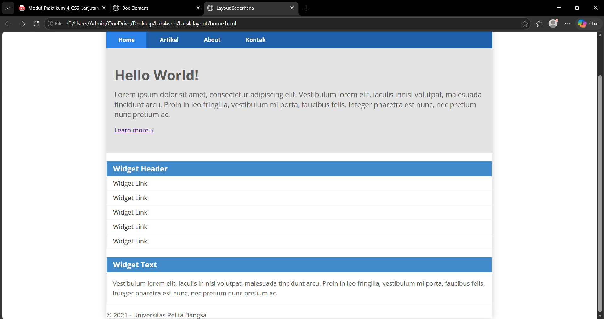

#### Langkah 11 - Membuat Widget dan Footer

Menambahkan widget header, daftar tautan, widget text, serta CSS untuk mengatur tampilan widget dan footer.

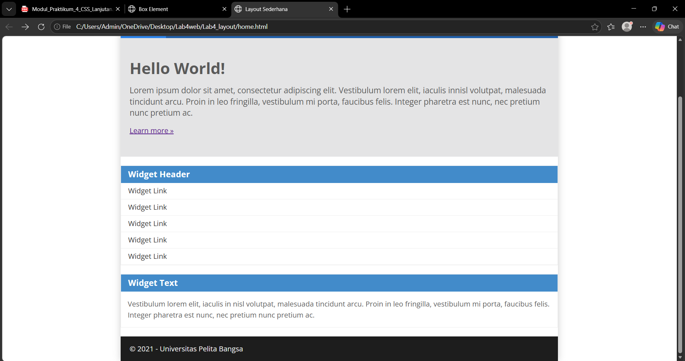

#### Langkah 12 - Menambahkan Kotak Konten

Menambahkan tiga kotak konten yang berisi gambar, heading, paragraf, dan tautan View detail. CSS digunakan untuk mengatur posisi kotak, ukuran, perataan teks, dan bentuk gambar lingkaran.

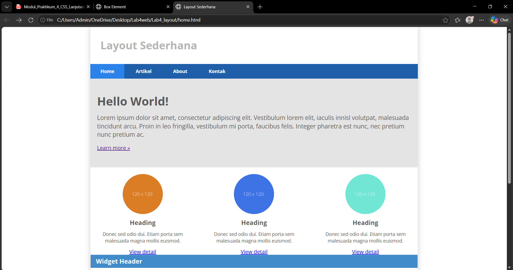

#### Langkah 13 - Menambahkan Artikel

Menambahkan dua artikel dengan judul, gambar, dan paragraf. CSS digunakan untuk mengatur jarak, garis pemisah, sudut gambar, serta posisi gambar di kiri dan kanan.

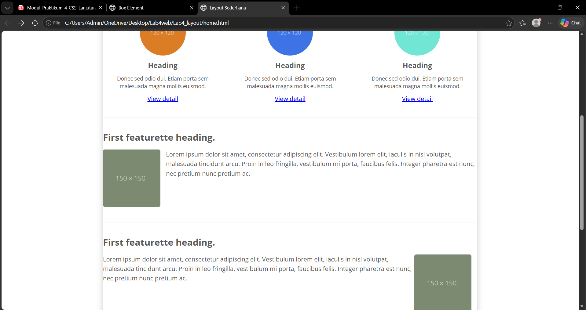

### 4. Hasil Praktikum

Praktikum menghasilkan halaman web dengan tata letak sederhana yang terdiri dari header, navigasi, hero panel, tiga kotak konten, artikel, sidebar, dan footer. Selain itu, dibuat halaman terpisah untuk mempelajari penggunaan CSS float dan clear pada elemen div.

### 5. Kesimpulan

Berdasarkan praktikum yang telah dilakukan, CSS dapat digunakan untuk mengatur posisi, ukuran, warna, jarak, dan tampilan elemen pada halaman web. Properti `float` dan `clear` membantu mengatur tata letak elemen, sedangkan pengaturan lainnya digunakan untuk membentuk halaman web yang lebih terstruktur.